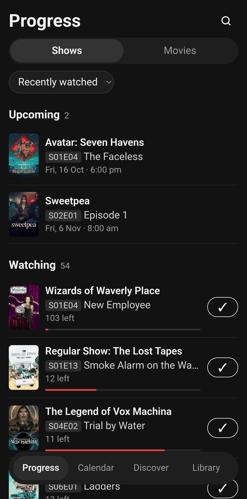
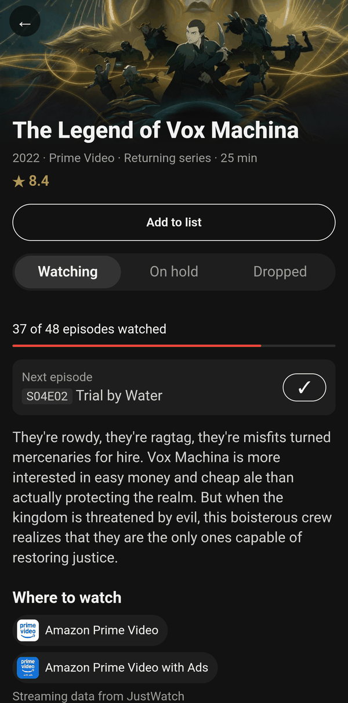
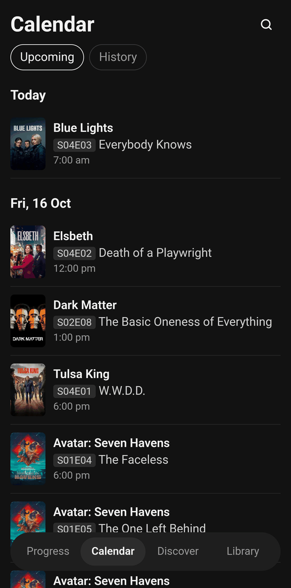
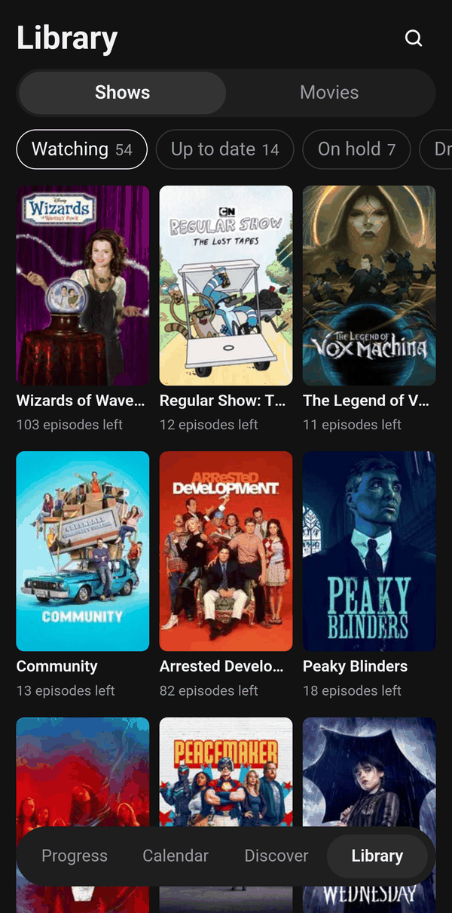
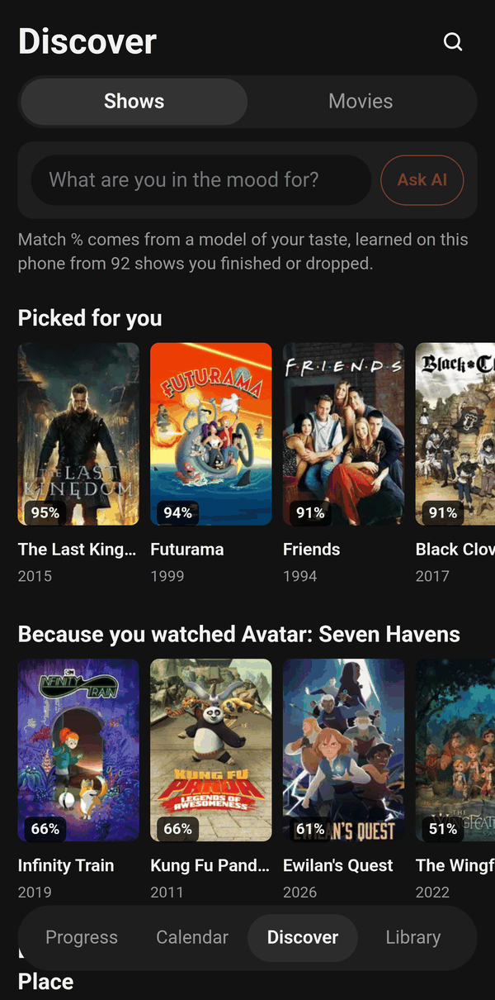
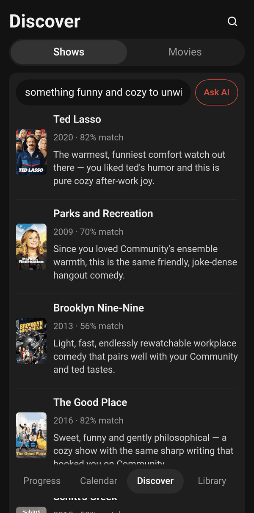
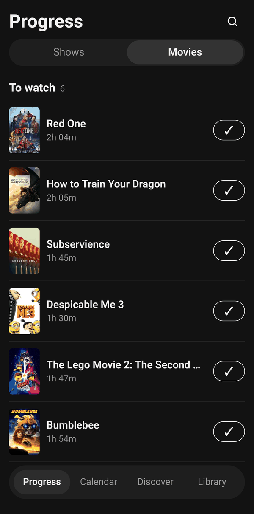
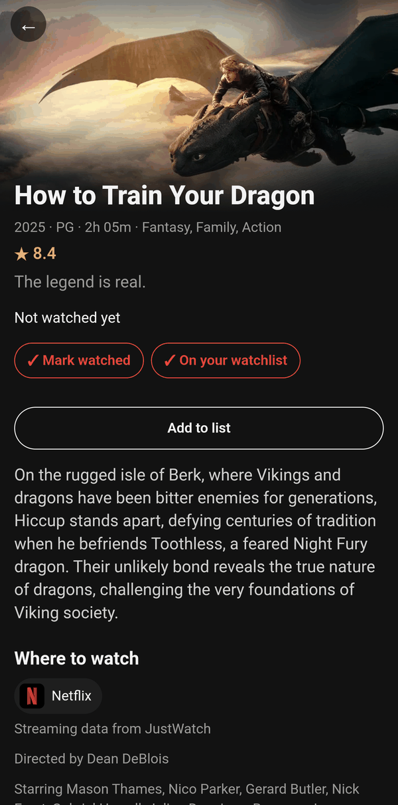

<p align="center">
  
</p>

<h1 align="center">Nextep</h1>

<p align="center">
  <b>What's the next episode I should watch?</b><br>
  A lean, open-source TV and movie tracker for Android, synced with Trakt and written in Rust.
</p>

<p align="center">
  <a href="https://github.com/SilverCrocus/nextep/releases/latest"></a>
  <a href="https://github.com/SilverCrocus/nextep/actions/workflows/ci.yml"></a>
  
  <a href="LICENSE"></a>
</p>

<p align="center">
  <a href="https://github.com/SilverCrocus/nextep/releases/latest"><b>Download the APK</b></a>
  &nbsp;·&nbsp; <a href="#install">Install</a>
  &nbsp;·&nbsp; <a href="#features">Features</a>
  &nbsp;·&nbsp; <a href="#build-from-source">Build from source</a>
</p>

Nextep reads your watch history from [Trakt](https://trakt.tv) and keeps the
next episode of every show you're watching one tap away. Because everything
lives on Trakt, whatever another app scrobbles there (Stremio with its Trakt
add-on, for example) shows up in Nextep on its own. There's no Nextep account,
no server in between, and no ads or tracking.

<table>
  <tr>
    <td align="center"><br><sub>Progress</sub></td>
    <td align="center"><br><sub>Show page</sub></td>
    <td align="center"><br><sub>Calendar</sub></td>
    <td align="center"><br><sub>Library</sub></td>
  </tr>
  <tr>
    <td align="center"><br><sub>Discover, with match %</sub></td>
    <td align="center"><br><sub>AI picks for a mood</sub></td>
    <td align="center"><br><sub>Movies to watch</sub></td>
    <td align="center"><br><sub>Movie page</sub></td>
  </tr>
</table>

> **Status:** young but used every day. Not on Google Play or F-Droid;
> releases are signed APKs on GitHub. See [docs/ROADMAP.md](docs/ROADMAP.md)
> for what's done, what's next, and what was left out on purpose.

## Why Nextep

Nextep started as a replacement for [Showly](https://github.com/trakt/showly),
a great Trakt client that has grown large over the years: news feeds,
comments, premium tiers, analytics and dozens of settings. Nextep keeps the
parts that get used every day and drops the rest.

- **Lighter.** A handful of screens and a short Settings page. Every
  screen opens straight away from its last saved copy, then refreshes.
- **Sorting that makes sense.** New episodes come first. *Upcoming* only lists
  shows you're caught up on, so a show you're 40 episodes behind on never
  pretends to be "coming soon". Everything else is ordered by what you
  watched last.
- **Works with Stremio.** Stremio's Trakt add-on scrobbles what you watch to
  Trakt, so Progress moves on by itself. Lists you make in Nextep are plain
  Trakt lists, so the add-on can show them in Stremio too.
- **Labels that tidy up after themselves.** Put a show *On hold* or mark it
  *Dropped* and it leaves Progress and Calendar. The label is saved on Trakt,
  so it survives a reinstall, and watching an episode again clears it.

## Features

**Progress**
- Three sections: **New episodes** (aired in the last 7 days),
  **Upcoming** (airing in the next 30 days, only for shows you're caught up
  on) and **Watching** (everything else with an episode waiting).
- One tap on ✓ marks the next episode watched on Trakt.
- Sort by recently watched, title, fewest left or newest episode. Pull to
  refresh.
- A **Shows | Movies** switch: movies from your watchlist to watch, and ones
  coming soon.

**Calendar**
- Upcoming episodes of the shows you follow for the next month, grouped by
  day, plus release dates of movies on your watchlist.
- **History**: what you watched recently.

**Show and movie pages**
- Artwork, overview, runtime and Trakt rating.
- Shows: network and status, seasons with your progress, single episodes to
  mark watched, and **Watching / On hold / Dropped**.
- Movies: mark watched, watchlist, how many times you've seen it, director
  and cast.
- **Where to watch**: subscription, free and ad-supported services in your
  country (JustWatch data via TMDB).
- **Add to list** for any of your Trakt lists.

**Library**
- Shows by state: Watching, Up to date, Finished, On hold, Dropped, Watchlist.
  Movies: Watched and Watchlist.
- **Lists**: create, rename and delete Trakt lists and add shows and movies
  to them. Lists generated by couchmoney or mdblist appear read-only as
  recommendations.
- Stats from Trakt: episodes, time spent, shows and your top genres.

**Discover**
- Rows for shows (or movies) you haven't seen: *Picked for you*, *Because you
  watched …* your last three, *Recommended by Trakt* and *Trending*.
- **Match %** on every poster from a small "would I like it?" model trained on
  your own history, on the phone. Shows you finished or kept watching count
  as liked; dropped, on hold or abandoned ones don't. It weighs genres,
  network, decade, rating and episode length, and appears once there are
  enough shows to learn from.
- **AI picks** (optional): describe a mood and an AI suggests up to ten
  titles, each with a reason. It can suggest anything that fits, not just
  what's in the rows; every suggestion is looked up on Trakt, and ones Trakt
  doesn't have or you've already seen are dropped. See
  [AI picks](#ai-picks-optional).

**Also**
- **Search** shows and movies and add them to your watchlist.
- **New-episode alerts** (optional, in Settings): a notification when a new
  episode of a show you're caught up on airs. Shows on hold or dropped are
  left out. Alerts are scheduled with Android whenever Progress refreshes, so
  they arrive with the app closed; open Nextep now and then to keep them
  coming.
- **Profile**: your Trakt avatar, name and totals (shows, episodes, movies,
  time watched), with Settings and sign-out. It's the person icon at the top
  right of every tab.
- **Home-screen widget**: *Up next* shows your next four episodes (what you
  can watch now first, then what's airing soon) and opens Nextep when
  tapped. It's updated whenever Progress refreshes.
- **Marking something watched** takes it off your watchlist.
- **Works offline**: the last good result of each screen is saved on the
  phone.
- **Updates itself** from GitHub Releases, no Obtainium needed (see
  [Updating](#updating)).

## Install

You need an Android phone running Android 7.0 or newer with a 64-bit ARM
processor (nearly every phone from the last several years), and a free
[Trakt](https://trakt.tv) account.

**Download the APK**

1. On your phone, download the latest `nextep-x.y.z.apk` from
   [Releases](https://github.com/SilverCrocus/nextep/releases/latest).
2. Open it. The first time, Android asks you to allow installs from your
   browser or file manager.

**Or use [Obtainium](https://github.com/ImranR98/Obtainium)**

Tap **Add App**, paste `https://github.com/SilverCrocus/nextep` and install.
Obtainium then watches for new releases.

**Sign in**

Open Nextep, tap **Sign in with Trakt**, then **Copy code & open Trakt**.
Paste the code on Trakt, approve, and come back: Nextep carries on by itself.
The first load checks every show you've watched, so it can take a moment;
after that, screens open instantly.

## Updating

Nextep keeps itself up to date; no app store or Obtainium needed.

- **Automatically** (Android 12 and newer): each time Nextep opens, it checks
  GitHub for a new release, downloads it in the background, and installs it a
  few seconds after you leave the app, without asking. Android only allows
  this once you've let Nextep install apps (it asks the first time you
  update), and you can turn it off in **Settings → Updates**.
- **With a tap**: when a new release is out, a banner says *Nextep x.y.z is
  available*. Tap **Update**, or use **Check for updates** in Settings.
  Where Android needs a confirmation (older Android versions, or when
  another app such as Obtainium manages Nextep's updates on that phone), it
  shows its installer screen.

The first time, Android asks you to allow Nextep to install apps: allow it,
come back, and tap **Update** again. Nextep only installs APKs from its own
GitHub releases.

Obtainium works just as well if you already use it; Settings tells you when
it's the one managing Nextep's updates.

Every release is signed with the same key, so updates install over the
existing app and keep your data.

## AI picks (optional)

AI picks use your own API key with DeepSeek or any other provider that offers
an OpenAI-compatible chat API. Without a key, Discover works as usual and
the AI box just points you to Settings.

1. Get an API key from [DeepSeek](https://platform.deepseek.com) (the
   default) or another OpenAI-compatible provider.
2. In Nextep, open **Profile (the person icon at the top right) → Settings → AI picks**. Leave the provider URL
   at `https://api.deepseek.com` or enter your provider's, paste the key, tap
   **Check key** to load the provider's models, choose one and tap **Save**.
3. In Discover, type what you're in the mood for and tap **Ask AI**. The
   Shows | Movies switch decides which you get.

**Thinking** is off by default, which answers in a few seconds. Turning it up
makes answers slower (a minute or more on Max) without clearly better picks.

**What is sent:** nothing until you tap **Ask AI**. Then a single request
goes to your provider with your mood, titles you watched, liked and dropped,
cast and crew from shows you liked, and candidate titles from Discover's
rows. The key is stored only on your phone, and the provider bills its usage
to your key.

## Privacy

Nextep has no server, no account of its own, no analytics and no ads. The
app talks directly to:

- **Trakt**: sign-in, your watch history, labels, lists and recommendations.
- **TMDB**: artwork and where-to-watch data.
- **GitHub**: checking for and downloading updates.
- **Your AI provider**: only if you set up AI picks, and only when you tap
  **Ask AI**.

Your Trakt sign-in, AI key and saved screens stay in Nextep's private storage
on the phone, and the taste model behind Match % is trained and run there
too.

## How it works

Nextep is a Rust workspace with three parts:

| Part | What it does |
|------|--------------|
| [`crates/nextep-core`](crates/nextep-core) | Platform-independent logic: Trakt and TMDB clients, models, progress ordering, On hold / Dropped labels, the taste model, AI picks, alert planning and the update check. No UI or Android code, so it's unit tested on any machine with `cargo test -p nextep-core`. |
| [`src-tauri`](src-tauri) | The [Tauri 2](https://tauri.app) shell: the commands the UI calls, saved sign-in, settings and screen snapshots, notifications, and the in-app installer. The generated Android project lives in `src-tauri/gen/android` and is committed. |
| [`src`](src) | The UI, written with [Leptos](https://leptos.dev) and compiled to WebAssembly by [Trunk](https://trunkrs.dev). One file per screen: `progress.rs`, `calendar.rs`, `discover.rs`, `library.rs`, `lists.rs`, `show.rs`, `movies.rs`, `search.rs`, `profile.rs`, `settings.rs`. |

Each screen first shows the snapshot saved after its last successful load,
then asks Trakt for fresh data. That's why Nextep opens instantly and still
works offline. How Progress decides what goes where is written up in
[docs/ROADMAP.md](docs/ROADMAP.md#progress-ordering).

## Build from source

### Prerequisites

The versions below match [the release workflow](.github/workflows/release.yml).

- Rust, latest stable (the workspace uses edition 2024), with the
  WebAssembly and Android targets:
  ```sh
  rustup target add wasm32-unknown-unknown aarch64-linux-android
  ```
- Trunk and the Tauri CLI:
  ```sh
  cargo install trunk --version 0.21.14 --locked
  cargo install tauri-cli --version 2.12.2 --locked
  ```
- JDK 21, the Android SDK (platform-tools) and NDK (CI uses
  `30.0.16248370`), with `JAVA_HOME`, `ANDROID_HOME` and `NDK_HOME` set. See
  [Tauri's Android prerequisites](https://tauri.app/start/prerequisites/#android).

### API keys

Copy `.env.example` to `.env` and fill in:

- `TRAKT_CLIENT_ID`: create an app at <https://developer.trakt.tv/apps>.
  Only the Client ID is used. Sign-in uses Trakt's device-code flow, but
  token refresh must send the redirect URI registered with the app, so keep
  `REDIRECT_URI` in [`crates/nextep-core/src/trakt/mod.rs`](crates/nextep-core/src/trakt/mod.rs)
  matching it.
- `TMDB_API_KEY`: from <https://www.themoviedb.org/settings/api>.

`.env` is gitignored. [`src-tauri/build.rs`](src-tauri/build.rs) bakes both
keys into the build; CI passes them as environment variables instead.

### Build and install

With USB debugging on and the phone connected:

```sh
cargo tauri android build --debug --apk --target aarch64
adb install -r src-tauri/gen/android/app/build/outputs/apk/universal/debug/app-universal-debug.apk
```

Android only installs an update signed with the same key as the installed
app. Builds are signed with the release key from
`~/.android-keys/keystore.properties` when it exists, and otherwise with
your debug key, so uninstall the official release before installing your own
build (and the other way round).

### Checks

The same checks CI runs:

```sh
cargo fmt --all --check
cargo clippy -p nextep-core --all-targets -- -D warnings
cargo test -p nextep-core
cargo clippy -p nextep-ui --target wasm32-unknown-unknown -- -D warnings
```

## Releasing

For maintainers:

```sh
scripts/release.sh 0.9.0
```

This bumps the version in `Cargo.toml` and `src-tauri/tauri.conf.json`,
commits, tags `v0.9.0` and pushes. [The release workflow](.github/workflows/release.yml)
then builds a signed APK and publishes it on GitHub Releases, where the in-app
update banner and Obtainium find it.

Every release must be signed with the same key, or Android refuses to install
it as an update. The key is in the repository secrets
(`ANDROID_KEYSTORE_BASE64`, `ANDROID_KEYSTORE_PASSWORD`) and, for local
builds, in `~/.android-keys/` (see
`src-tauri/gen/android/app/build.gradle.kts`). Keep a backup of it.

## Credits

- [Trakt](https://trakt.tv) for watch history, lists, recommendations and
  search. Nextep is an independent app and isn't affiliated with Trakt.
- [TMDB](https://www.themoviedb.org) for artwork and where-to-watch data.
  *This product uses the TMDB API but is not endorsed or certified by TMDB.*
- [JustWatch](https://www.justwatch.com) for streaming availability, provided
  through TMDB.
- [Showly](https://github.com/trakt/showly), the app Nextep grew out of.
- Built with [Tauri](https://tauri.app), [Leptos](https://leptos.dev) and
  [Trunk](https://trunkrs.dev).

## License

[GPL-3.0-or-later](LICENSE). Nextep is inspired by Showly, which is also
GPL-3.0; any logic ported from Showly stays under the same license.
